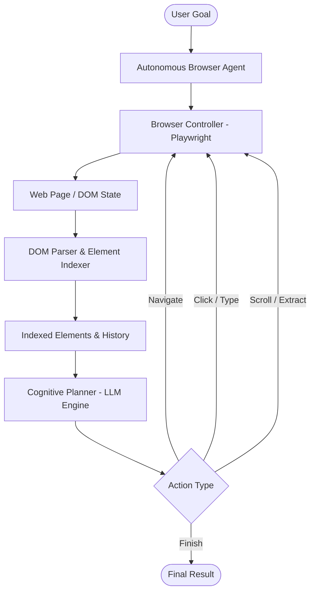

# Autonomous Web Agent 🌐🤖

[](https://www.python.org/)
[](https://github.com/prajwal0104/autonomous-web-agent/actions/workflows/ci.yml)
[](https://playwright.dev/)
[](https://opensource.org/licenses/MIT)
[](#supported-providers)

An autonomous AI browser agent capable of perceiving web pages, decomposing high-level user goals, executing multi-step interactions (clicks, inputs, navigation, scrolls), and extracting structured data in real time.

Built on **Playwright**, **Pydantic**, and modern **LLM Reasoning Architectures**.

---

## 🚀 Key Features

* **🧠 Goal-Driven Planning**: Takes high-level objectives (e.g. *"Search for recent machine learning papers and extract the top three abstracts"*) and decomposes them into sequential browser actions.
* **🎯 Deterministic DOM Indexing**: Parses dynamic web pages into indexed, accessibility-aware interactive elements (`buttons`, `inputs`, `links`, `selects`) with deterministic selectors to eliminate fragile XPath failures.
* **🔄 Vision & State Memory**: Maintains execution history, step outcomes, and observations across page transitions for error recovery and backtracking.
* **⚡ Multi-Provider Support**: Pluggable backend supporting **OpenAI (GPT-4o)**, **Google Gemini (1.5 Pro)**, and local models via **Ollama**.
* **🖥️ Visible or Headless Modes**: Run with a visible Chromium browser window to watch the agent navigate in real time, or headless for automated background workflows.

---

## 🏗️ Architecture



---

## 📦 Installation & Setup

### 1. Clone the Repository
```bash
git clone https://github.com/prajwal0104/autonomous-web-agent.git
cd autonomous-web-agent
```

### 2. Create and Activate Virtual Environment
```bash
# Windows (PowerShell)
python -m venv .venv
.\.venv\Scripts\Activate.ps1

# Linux / macOS
python -m venv .venv
source .venv/bin/activate
```

### 3. Install Dependencies
```bash
pip install -r requirements.txt
playwright install chromium
```

### 4. Configure Environment Variables
Copy `.env.example` to `.env` and provide your API keys:
```bash
cp .env.example .env
```
Edit `.env`:
```env
LLM_PROVIDER=openai
OPENAI_API_KEY=your_openai_key_here
HEADLESS=false
```

---

## 🎮 Quickstart Usage

### Interactive CLI Mode
Run the agent with a natural language goal:
```bash
python -m src.main --goal "Navigate to Hacker News and find trending posts about artificial intelligence"
```

### Run in Headless Background Mode
```bash
python -m src.main --goal "Find the latest release version on python.org" --headless
```

### Specify Provider & Max Steps
```bash
python -m src.main --goal "Search for upcoming sports tournaments" --provider gemini --max-steps 15
```

---

## 📂 Project Structure

```
autonomous-web-agent/
├── src/
│   ├── agent/
│   │   ├── browser_agent.py   # Core execution loop & lifecycle
│   │   ├── memory.py          # State tracking & observation history
│   │   └── planner.py         # Cognitive planning & LLM action dispatch
│   ├── browser/
│   │   ├── controller.py      # Playwright browser controller
│   │   └── dom_parser.py      # Interactive DOM element extraction & indexing
│   ├── tools/
│   │   └── extractor.py       # Structured table & link extractors
│   ├── config.py              # Pydantic settings & environment configuration
│   └── main.py                # Typer & Rich CLI interface
├── tests/
│   ├── test_agent.py          # Agent memory, planning, & action schemas
│   ├── test_dom_parser.py     # Interactive DOM element extraction & visibility tests
│   └── test_extractor.py      # Structured HTML table & link parsing tests
├── .env.example               # Template environment configuration
├── pyproject.toml             # Package metadata & build definition
├── requirements.txt           # Core runtime dependencies
└── README.md                  # Project documentation
```

---

## 🧪 Running Tests

Run the test suite with `pytest`:
```bash
pytest -v
```

---

## 📄 License

This project is licensed under the [MIT License](LICENSE).

Developed and maintained by [Prajwal Mahesh](https://github.com/prajwal0104).
